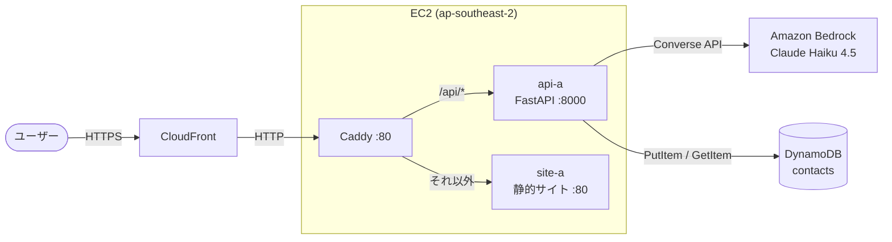

Hands-on notes · ap-southeast-2 (Sydney)

# AWS Hands-on & Architecture Notes

**FastAPI + Amazon Bedrock (Claude) + Docker (Caddy) + CloudFront** で構成したWebアプリを、AWS上にゼロから構築したときの手順とメモをまとめた手順書です。
{ .lead }

[最初のStepへ :material-arrow-right:](step1-infra.md){ .md-button .md-button--primary }
[GitHub :fontawesome-brands-github:](https://github.com/yuke0/aws-hands-on-notes){ .md-button }

## 全体アーキテクチャ

## ステップ一覧

-   :material-server-network:{ .lg .middle } **Step 1 · 基盤・IAM**

    ---

    EC2、セキュリティグループ、DynamoDB、IAMロールの設定

    [:octicons-arrow-right-24: 読む](step1-infra.md)

-   :material-robot-outline:{ .lg .middle } **Step 2 · Bedrock連携**

    ---

    FastAPI から Bedrock の Converse API で Claude を呼び出す

    [:octicons-arrow-right-24: 読む](step2-bedrock.md)

-   :material-docker:{ .lg .middle } **Step 3 · Docker & Caddy**

    ---

    Caddy をリバースプロキシに、静的サイトと API を同居させる

    [:octicons-arrow-right-24: 読む](step3-docker-caddy.md)

-   :material-shield-lock-outline:{ .lg .middle } **Step 4 · セキュリティ**

    ---

    APIキー認証（HMAC比較）とレートリミット

    [:octicons-arrow-right-24: 読む](step4-security.md)

-   :material-cloud-outline:{ .lg .middle } **Step 5 · 高度な設定・運用**

    ---

    CloudFront 配信、Bedrock 動作確認、AWS Budgets によるコスト管理

    [:octicons-arrow-right-24: 読む](step5-advanced.md)

## 技術スタック

| レイヤー | 採用技術 |
| --- | --- |
| リージョン | `ap-southeast-2` (シドニー) |
| 配信 | Amazon CloudFront |
| リバースプロキシ | Caddy 2 (Docker) |
| バックエンド | FastAPI / boto3 |
| 生成AI | Amazon Bedrock (`au.anthropic.claude-haiku-4-5-20251001-v1:0`) |
| データストア | Amazon DynamoDB (オンデマンド) |
| コスト管理 | AWS Budgets (月額 5 USD) |

!!! warning "公開前のチェック"
    アカウントID・セキュリティグループID・自宅IP・APIキー・メールアドレスは、このサイトにそのまま書かないでください。本書ではすべてプレースホルダ（`<ACCOUNT_ID>` など）にしています。
